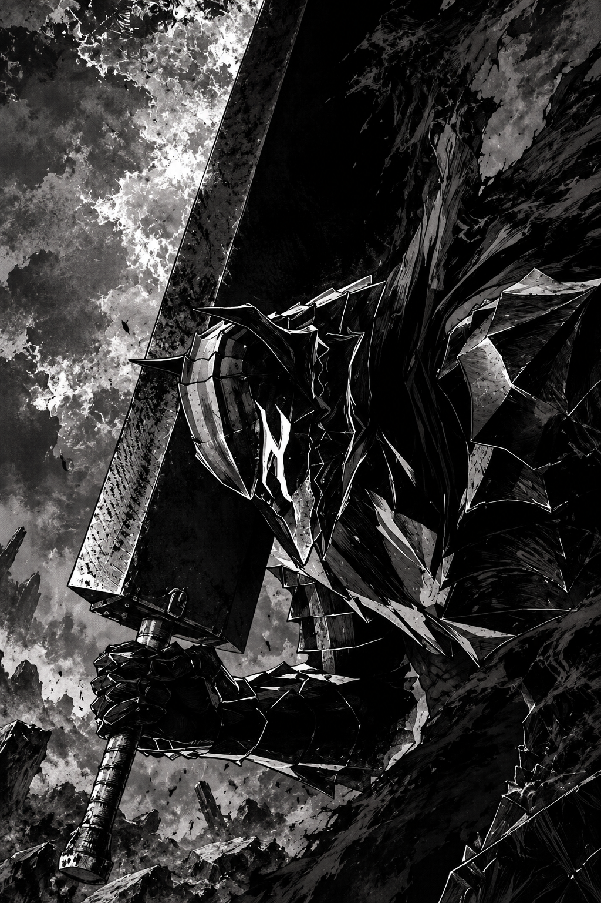

 

  
  &nbsp;
  
  &nbsp;
  

<pre>
📐  Matemática e resolução de problemas
🌌  Astronomia e ciência
🎨  Design e interfaces
📦  Criando a StudyBox
</pre>

   

<h3 align="center">Sobre mim</h3>

Gosto de transformar ideias em projetos reais e aprender enquanto construo. 
Tenho interesse em matemática, astronomia, tecnologia, design, economia e empreendedorismo.

 

<h3 align="center">Projeto em destaque</h3>

  <b>📦 StudyBox</b> 
  <i>Tudo para estudar. Do seu jeito.</i>

Projeto de empreendedorismo focado em caixas de materiais escolares prontas e personalizáveis.

  

  

<h3 align="center">Conquistas</h3>

🥇 Ouro Regional — Mathématiques sans Frontières 
🥈 Prata Nacional — Mathématiques sans Frontières 
🥈 Prata — Olimpíada Brasileira de Astronomia (OBA)

  

<h3 align="center">Ferramentas que uso ou estou aprendendo</h3>

  

  

<h3 align="center">GitHub</h3>

  
  

 

<h3 align="center"><code>BUILD • LEARN • IMPROVE</code></h3>

